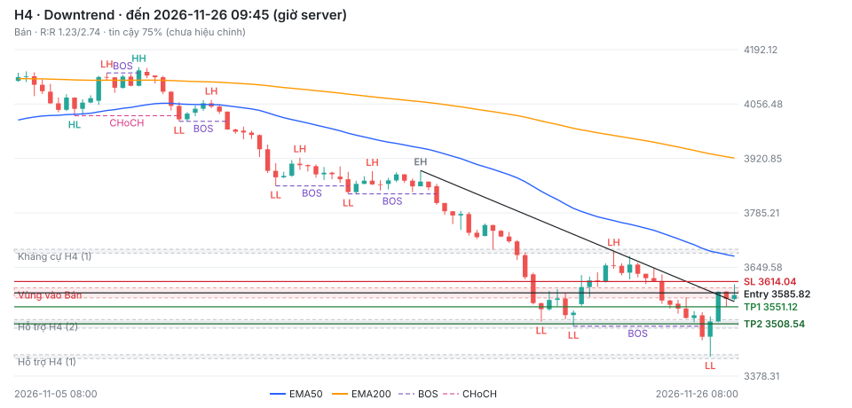
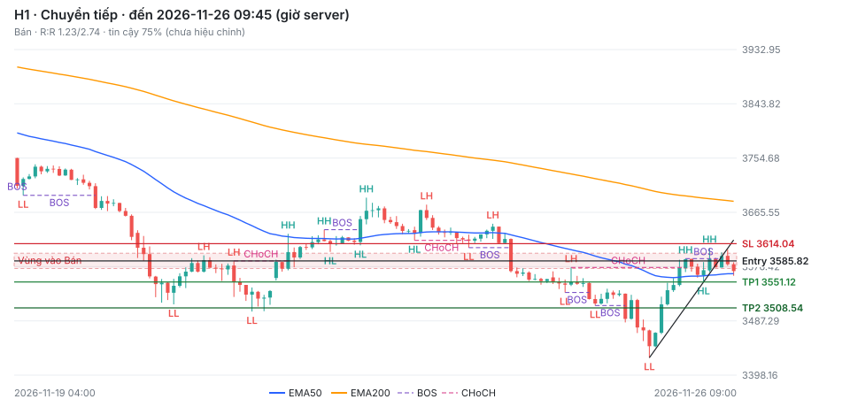
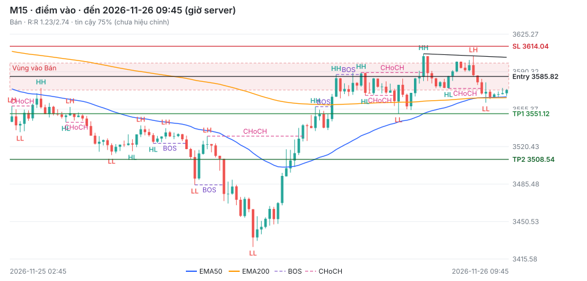

# Phân tích đa khung H4 → H1 → M15 (chức năng 2) — `mtf-scenario-v1`

> Chỉ để tham khảo. Phần này không gửi, sửa hay đóng lệnh. Kịch bản không đi vào bộ vào lệnh TREND/SIDEWAY.
> Cờ: `ZIQ_MARKET_INTEL_MTF_ENABLED`, mặc định **tắt**. PR này có bộ phân tích, script và tài liệu. Trang Control Center làm ở PR sau.

## Kết luận

- Bộ phân tích đi từ khung lớn xuống: H4 (xu hướng, vùng giá, order block) → H1 (đồng thuận, pha hồi/đẩy, vùng chờ) → M15 (tín hiệu tại vùng). Mỗi lần chạy cho ra **kịch bản chính** và **kịch bản thay thế**. Mỗi kịch bản có hướng, vùng vào, SL, TP1/TP2, R:R, điều kiện mất hiệu lực, độ tin cậy kèm bảng điểm, và 3 chart.
- **Tự chấm trên 3 năm dữ liệu (27/11/2023 → 26/11/2026), các kịch bản này chưa có lợi thế.** Có 3.063 kịch bản chính, 77% được khớp. TP1 đến trước SL chỉ **32%**, PF tính theo R là **0,62**, trung bình **−0,27 R** mỗi lệnh khớp (đã trừ 0,3 giá spread + trượt).
- **Độ tin cậy chưa đúng nghĩa xác suất.** Điểm trung bình 73%, nhưng tỷ lệ thắng thực tế chỉ 32%. Nhóm điểm 70–90 thắng 32,7%, nhóm 55–69 thắng 30,8%. Thứ tự có đi đúng chiều nhưng khoảng cách quá nhỏ để dùng được.
- Vì vậy: dùng kịch bản để **đọc cấu trúc và vùng giá**, không dùng để vào lệnh. Bảng điểm được giữ nguyên (đã commit trước khi chạy trên dữ liệu thật). Mọi chỉnh sửa sẽ đi qua chức năng 1 (đề xuất → backtest ngoài mẫu → anh duyệt).

## Cách phân tích

1. **H4 — xu hướng chính.** Trạng thái theo thư viện mẫu (chức năng 3): Uptrend → ưu tiên MUA, Downtrend → ưu tiên BÁN, Sideway → vào ở biên gần nhất, Chuyển tiếp → dùng hướng H1 nếu có, không thì không đưa kịch bản. Vùng giá H4 gồm:
   - Hỗ trợ/kháng cự: gom các swing cách nhau dưới 0,5 ATR thành một vùng, ghi số lần chạm.
   - Order block (vùng cung/cầu): nến ngược chiều cuối cùng trước cú phá BOS/CHoCH. Order block bị loại khi có nến đóng cửa xuyên qua nó.
2. **H1 — xác nhận.** H1 đồng thuận, trung tính hay ngược H4. Pha đẩy (giá vượt swing gần nhất theo hướng xu hướng) hay pha hồi. Vị trí của giá trong nhịp swing H1 gần nhất: nửa dưới là discount, nửa trên là premium.
3. **Vùng vào lệnh.** Gộp các vùng cùng phía (order block H1/H4, hỗ trợ/kháng cự có ≥ 2 lần chạm, EMA50 H1 ± 0,3 ATR) nằm trong khoảng 4 ATR H1. Vùng nào chồng nhau thì gộp lại (hội tụ). Chọn vùng gần giá nhất, độ rộng tối đa 1,5 ATR H1.
4. **M15 — điểm kích hoạt.** Trong 8 nến M15 gần nhất, giá đã chạm vùng chưa. Sau khi chạm, có BOS/CHoCH, nến engulfing, hoặc quét thanh khoản (râu xuyên đáy/đỉnh 10 nến rồi đóng ngược lại) theo hướng lệnh không.
5. **SL / TP.**
   - SL đặt ngoài vùng thêm 0,25 ATR H1. Nếu đáy/đỉnh swing H1 nằm sát dưới/trên vùng thì SL đặt ngoài swing đó.
   - TP1 là đỉnh/đáy swing H1 hoặc vùng giá gần nhất cách entry ≥ 1R. Nếu không có thì TP1 = 1,5R.
   - TP2 là vùng H4 tiếp theo sau TP1. Nếu không có thì TP2 = 3R.
6. **Mất hiệu lực:** nến H1 đóng cửa vượt SL, hoặc H4 có CHoCH ngược hướng.
7. **Đối chiếu luật bot:** mỗi kịch bản ghi khoảng cách SL so với luật 6–10 giá của bot.

## Độ tin cậy: bảng điểm cố định

| Yếu tố | Điểm |
|---|---|
| Điểm nền | +30 |
| H4 cùng hướng / H4 sideway vào ở biên / H4 chưa rõ / ngược H4 | +20 / +10 / 0 / −15 |
| H1 đồng thuận / trung tính / ngược hướng | +15 / +5 / −10 |
| MUA ở discount (BÁN ở premium) / ngược lại | +10 / −5 |
| Vùng hội tụ ≥ 2 nguồn / một nguồn | +10 / +5 |
| M15 đã có tín hiệu / đã chạm vùng chưa có tín hiệu / chưa chạm | +15 / +5 / 0 |
| R:R TP1 ≥ 1,5 / R:R TP1 < 1 | +5 / −10 |
| Giới hạn | 5 đến 90 |

Bảng điểm nằm trong `CONFIDENCE_POINTS` (`packages/market-intel/src/scenario.mjs`). Nó được commit trước khi chạy đánh giá trên dữ liệu thật (commit `3609473`). Sau đó không chỉnh.

## Ví dụ: 26/11/2026 09:45 (giờ server)

Đây là kết quả của chính bộ phân tích tại thời điểm dữ liệu kết thúc. **Không phải tín hiệu vào lệnh.** Chi tiết đầy đủ ở [mtf-example/analysis.md](mtf-example/analysis.md).

- H4 Downtrend → ưu tiên BÁN. H1 đang Chuyển tiếp.
- Kịch bản chính: BÁN ở vùng 3573,25–3598,40 (EMA50 H1 + kháng cự H1 12 lần chạm + order block H1). SL 3614,04 (cách 28 giá, rộng hơn luật bot). TP1 3551,12 (R:R 1,23), TP2 3508,54 (R:R 2,74). Tin cậy 75% theo bảng điểm. Theo số liệu bên dưới, tỷ lệ thắng thực tế của nhóm điểm này khoảng 33%.
- Kịch bản thay thế: MUA ở 3556,46–3573,24, tin cậy 50%.





## Tự chấm trên lịch sử

Cách chấm (`scripts/market-intel/mtf-scenario-eval.mjs`):

- Cứ 4 nến H1 đóng thì dựng kịch bản một lần, chỉ dùng nến đã đóng. Sau đó theo dõi các nến M15 tiếp theo, tối đa 24 giờ.
- Khớp khi giá chạm entry, giá vào bị cộng thêm 0,3 giá chi phí.
- Sau khi khớp: chạm SL trước thì thua, chạm TP1 trước thì thắng. Nếu cả hai nằm trong cùng một nến thì tính là thua (STOP_FIRST). Không tính TP1 ngay trên nến vừa khớp.
- Có nến M15 đóng vượt SL trước khi khớp thì kịch bản bị hủy. Hết 24 giờ mà lệnh vẫn mở thì tính theo giá đóng cửa.
- Mốc chia: trước 25/11/2025 là dữ liệu **chưa ai xem**, sau mốc đó là 12 tháng đã dùng ở các vòng nghiên cứu trước.

**Kịch bản chính theo nhóm điểm:**

| Nhóm điểm | Giai đoạn | Kịch bản | Khớp | TP1 trước SL | R TB | PF (R) |
|---|---|---|---|---|---|---|
| 70–90 | chưa xem (11/2023–11/2025) | 1.370 | 78% | 29,6% | −0,30 | 0,60 |
| 70–90 | đã xem (11/2025–11/2026) | 757 | 79% | 38,4% | −0,14 | 0,77 |
| 55–69 | chưa xem | 510 | 75% | 27,2% | −0,44 | 0,44 |
| 55–69 | đã xem | 261 | 77% | 37,8% | −0,10 | 0,84 |
| 40–54 | chưa xem | 106 | 74% | 16,2% | −0,67 | 0,24 |
| 40–54 | đã xem | 53 | 60% | 62,5% | +0,44 | 2,14 |
| **Tất cả** | **3 năm** | **3.063** | **77%** | **32,1%** | **−0,27** | **0,62** |

Nhóm 5–39 chỉ có 6 kịch bản nên không đưa vào bảng. Nhóm 40–54 của năm gần nhất chỉ có 32 lệnh khớp, quá ít để tin.

**Kịch bản chính theo đặc điểm (3 năm):**

| Nhóm | Kịch bản | TP1 trước SL | R TB | PF (R) |
|---|---|---|---|---|
| M15 đã có tín hiệu | 1.570 | 36,1% | −0,18 | 0,73 |
| M15 đã chạm, chưa có tín hiệu | 524 | 36,4% | −0,17 | 0,75 |
| M15 chưa chạm vùng | 969 | 19,7% | −0,54 | 0,37 |
| SL < 6 giá | 1.296 | 24,4% | −0,49 | 0,41 |
| SL 6–10 giá (đúng luật bot) | 790 | 36,4% | −0,13 | 0,81 |
| SL > 10 giá | 977 | 40,9% | −0,04 | 0,93 |
| MUA | 1.831 | 32,7% | −0,21 | 0,70 |
| BÁN | 1.232 | 31,4% | −0,34 | 0,53 |

Kịch bản thay thế (2.480): TP1 trước SL 30,0%, PF 0,56.

**Đọc kết quả:**

- Hai năm chưa xem (11/2023 → 11/2025) cho kết quả kém hơn rõ: PF 0,54. Năm đã xem có PF 0,82. Không nên lấy năm gần nhất làm chuẩn.
- SL quá hẹp (< 6 giá, tức vùng hẹp trên H1) là nhóm tệ nhất. Đây là ứng viên đề xuất đầu tiên cho chức năng 1: bỏ kịch bản có SL hẹp hơn 6 giá. Đề xuất đó phải được chọn trên đoạn đầu và kiểm trên đoạn sau.
- Chờ M15 chạm vùng và có tín hiệu tốt hơn rõ so với vào khi giá chưa tới vùng (36% so với 20%). Nhưng ngay cả nhóm tốt nhất vẫn chưa dương.

## Điều chưa kiểm chứng được

- Đánh giá chỉ thoát toàn bộ ở TP1. Chưa áp quản lý lệnh của bot (BE +6, chốt 1/3 ở +10, FastMove, M5 handoff). Bot thật quản lý lệnh khác, nên kết quả có thể khác.
- Chi phí cố định 0,3 giá cho mỗi lệnh. Spread thật thay đổi theo phiên và tin tức.
- Các kịch bản chồng nhau theo thời gian (mỗi 4 giờ một lần), nên các lệnh không độc lập với nhau.
- Order block và hỗ trợ/kháng cự được định nghĩa bằng luật đơn giản, có thể khác với cách anh tự vẽ bằng mắt.

## Xem trên Control Center

Trang **Kỹ thuật → Phân tích thị trường** (`/market-intel`) hiện trạng thái thư viện mẫu, phân tích H4 → H1 → M15, hai kịch bản và 3 chart (M15 trước).

- **Thời gian thực:** trang tự cập nhật khoảng 20 giây sau mỗi nến M15 đóng. Nút **Cập nhật** dựng lại ngay (bấm liên tục trong 10 giây chỉ nhận lần đầu, để không dồn yêu cầu vào bridge).
- **Chart dự kiến:** trên M15 và H1, phần nền xám bên phải nến cuối vẽ đường đi nếu kịch bản chính đúng: giá hiện tại → Entry → TP1 → TP2 (nét đứt cùng màu hướng lệnh) và nhánh Entry → SL (đỏ). Đây là hình minh hoạ để anh cân nhắc vào lệnh tay, không phải dự báo, và trang không đặt lệnh.
- API: `GET /api/v1/market-intel/snapshot[?refresh=1]`, chỉ có route GET.
  - Nến lấy từ MT5 bridge (`GET /v1/candles`, 400 nến M15/H1/H4), bỏ nến đang hình thành.
  - Mỗi nến M15 chỉ dựng một lần; nếu bridge chưa kịp trả nến vừa đóng thì lần gọi sau sẽ dựng lại.
- Bật trên máy bot, trong môi trường của API: `ZIQ_MARKET_INTEL_REGIME_LIBRARY_ENABLED=true` (trạng thái thị trường) và/hoặc `ZIQ_MARKET_INTEL_MTF_ENABLED=true` (kịch bản + chart), rồi khởi động lại API theo quy trình Phase 7C. Khi cả hai tắt, API không gọi bridge và trang chỉ báo "đang tắt".

## Chạy

```bash
# một lần phân tích + 3 chart (mặc định: thời điểm cuối dữ liệu; --at để chọn thời điểm khác)
pnpm market-intel:mtf --h4 XAUUSD_H4.csv --h1 XAUUSD_H1.csv --m15 XAUUSD_M15.csv [--at "2026-11-20 14:00"]

# tự chấm trên lịch sử
pnpm market-intel:mtf-eval --h4 XAUUSD_H4.csv --h1 XAUUSD_H1.csv --m15 XAUUSD_M15.csv --split 2025-11-25
```

Kết quả nằm trong `.runtime/market-intel/` (không commit).
