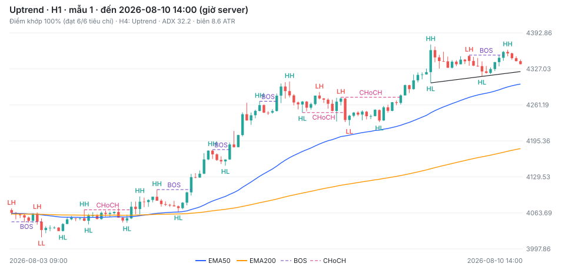
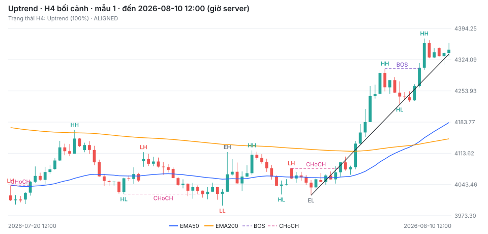
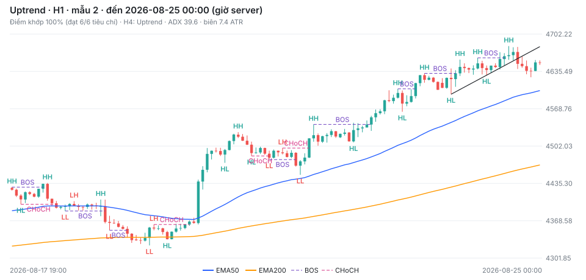
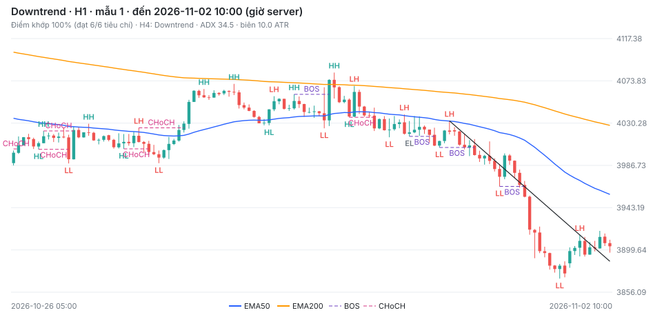
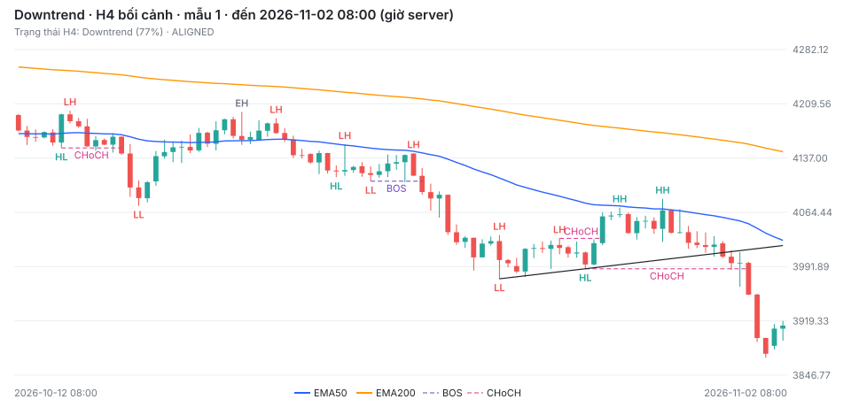
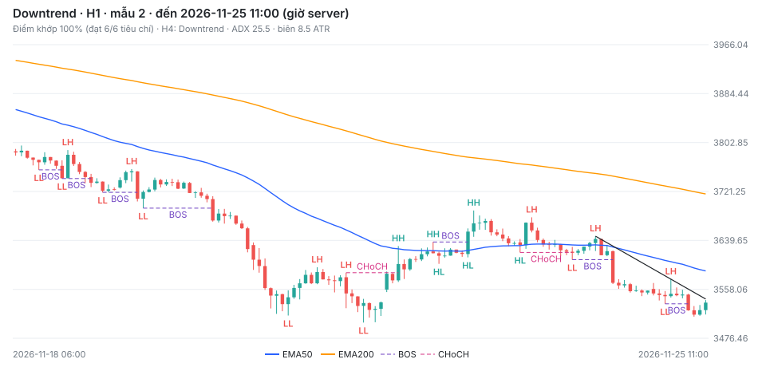
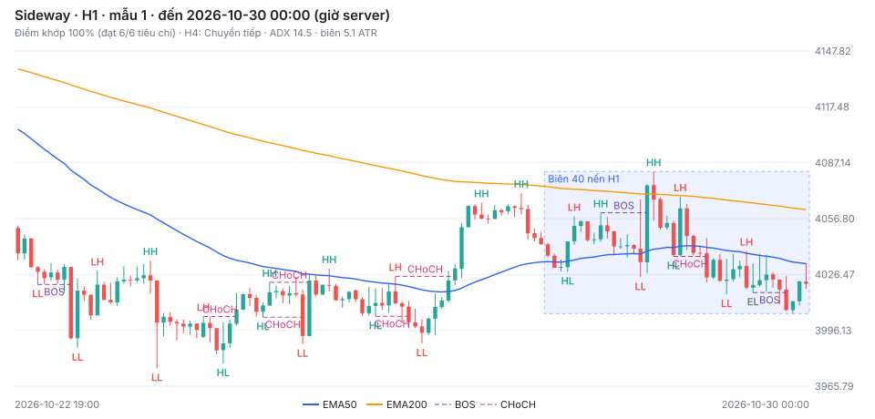
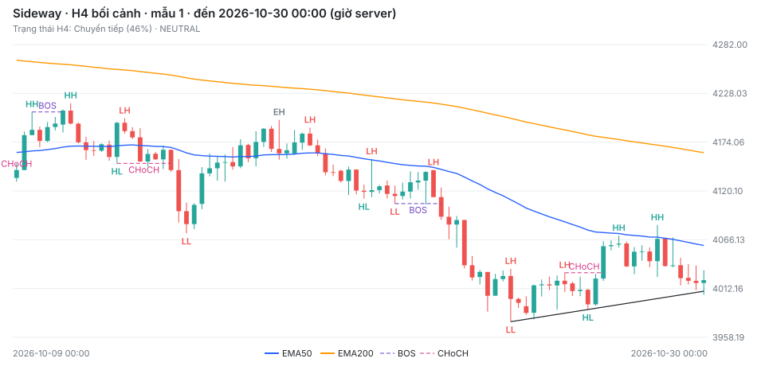
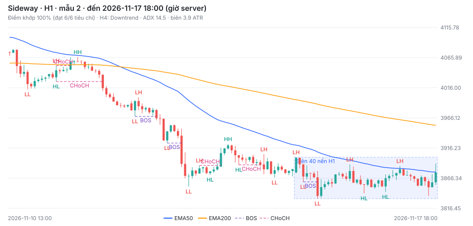

# Thư viện mẫu thị trường (chức năng 3) — `regime-library-v1`

> Phần này chỉ đọc dữ liệu và đưa ra tham khảo. Nó không gửi, sửa hay đóng lệnh nào, không đổi BOT_MODE hay runtime. Bộ phân loại regime đang chạy (`MarketRegimeClassifier`, quyết định TREND / SIDEWAY / PAUSE) vẫn giữ nguyên.
> Cờ: `ZIQ_MARKET_INTEL_REGIME_LIBRARY_ENABLED`, mặc định **tắt**. PR này chỉ có thư viện, script báo cáo và tài liệu. Chưa có tiến trình nào của bot gọi tới nó.

## Kết luận

- Thư viện chia thị trường thành **Uptrend, Downtrend, Sideway** và **Chuyển tiếp** (không khớp rõ mẫu nào). Việc chia dựa trên 6 tiêu chí định lượng cho mỗi mẫu, chấm trên H1 và đối chiếu với H4.
- Trên 12 tháng dữ liệu MT5 (25/11/2025 → 25/11/2026, 5.712 nến H1): Uptrend 19%, Downtrend 23%, Sideway 15%, Chuyển tiếp 44%.
- **Phát hiện đáng chú ý nhất (trong mẫu, chưa phải bằng chứng):** chấm 625 lệnh backtest của cấu hình hiện tại theo trạng thái thư viện lúc vào lệnh:

  | Nhóm lệnh | Lệnh | Thắng | PF | USD (0,12 lot) | R TB |
  |---|---|---|---|---|---|
  | Cùng hướng xu hướng (BUY khi Uptrend, SELL khi Downtrend) | 216 | 40,3% | **1,32** | +2.776 | +0,15 |
  | Ngược hướng xu hướng | 52 | 17,3% | 0,27 | −2.341 | −0,46 |
  | Vào khi Sideway | 64 | 28,1% | 0,70 | −1.025 | −0,15 |
  | Vào khi Chuyển tiếp | 293 | 28,7% | 0,69 | −4.166 | −0,16 |
  | Tất cả (cấu hình hiện tại) | 625 | 31,7% | 0,83 | −4.757 | −0,08 |

  Nhóm "cùng hướng" dương ở cả nửa đầu (85 lệnh, PF 1,55) lẫn nửa sau (131 lệnh, PF 1,16).
- **Đây chưa phải lý do để đổi bot.** Hai ngưỡng của mẫu Sideway được chọn sau khi xem phân bố chỉ báo của chính 12 tháng này (xem "Cách đặt ngưỡng"). Ngưỡng của mẫu xu hướng thì không chỉnh. Bộ lọc "chỉ vào cùng hướng thư viện" sẽ là đề xuất đầu tiên cho chức năng 1. Nó chỉ được đưa ra duyệt sau khi qua walk-forward trên dữ liệu 2023–2025 mà anh sẽ xuất.
- Mức đồng thuận với bộ phân loại đang chạy chỉ **42,6%** (tính trên từng nến M15). Phần lớn chênh lệch đến từ việc bộ đang chạy gọi gần một nửa số nến M15 là REVERSAL. Hai bộ nhìn ở hai khung khác nhau: bộ đang chạy dùng M15, thư viện dùng H1 và H4.

## Cách phân loại

1. Ghép nến M15 thành H1 và H4 theo giờ server (H4 bắt đầu lúc 00, 04, 08…). Nhóm nào thiếu quá nửa số nến M15 thì bỏ, ví dụ phiên ngày lễ. Khi có file H1/H4 xuất thẳng từ MT5 thì dùng file đó (`--h1`, `--h4`).
2. Trên mỗi khung, tính EMA50, EMA200, ATR14, ADX14 (+DI/−DI), swing fractal 3 nến hai bên, BOS/CHoCH. Mọi giá trị đều nhân quả: tại nến i chỉ dùng các nến ≤ i. Một swing chỉ "tồn tại" từ khi đủ 3 nến xác nhận bên phải. Đã có test khóa điều này.
3. Chấm điểm từng mẫu = tổng trọng số tiêu chí đạt / tổng trọng số. Mẫu thắng phải có điểm ≥ 70% **và** hơn mẫu thứ hai ít nhất 15 điểm. Nếu không đạt thì gọi là **Chuyển tiếp**.
4. Kết hợp khung: trạng thái cuối = trạng thái H1. Nếu H1 và H4 là hai xu hướng ngược nhau thì trạng thái cuối là Chuyển tiếp (`CONFLICT`). Khi H1 và H4 cùng xu hướng thì ghi `ALIGNED`.

Hai swing gần nhất cách nhau dưới 0,1 ATR được coi là bằng nhau (EH / EL, đỉnh/đáy bằng = vùng thanh khoản).

## Uptrend

**Nhận diện:** giá nằm trên EMA50, EMA50 trên EMA200 và đang dốc lên, ADX đủ mạnh với +DI dẫn. Đỉnh sau cao hơn đỉnh trước (HH), đáy sau cao hơn đáy trước (HL). Lần phá cấu trúc gần nhất là phá lên.

| Tiêu chí | Ngưỡng | Trọng số |
|---|---|---|
| Giá so với EMA50 | close > EMA50 | 1 |
| EMA50 so với EMA200 | EMA50 > EMA200 | 1 |
| Độ dốc EMA50 | tăng ≥ 0,5 ATR trong 10 nến | 1 |
| ADX(14) | ≥ 22 và +DI > −DI | 1 |
| Cấu trúc swing | HH + HL | 1,5 |
| Sự kiện cấu trúc gần nhất | BOS/CHoCH phá lên | 1 |

**Chart mẫu** (H1 kèm H4 bối cảnh, giờ server):





Đường đen nối hai đáy HL gần nhất là đường xu hướng. Nét đứt tím là BOS, nét đứt hồng là CHoCH.

**Nên dùng:** mua theo xu hướng sau nhịp hồi về EMA50 hoặc về đáy HL vừa tạo, và mua phá đỉnh có BOS xác nhận. Trên 12 tháng, lệnh TREND BUY vào lúc thư viện báo Uptrend có 86 lệnh, PF 1,41.

**Nên tránh:** SELL ngược xu hướng. Lệnh TREND SELL vào lúc Uptrend có 21 lệnh, thắng 9,5%, PF 0,07, −1.442 USD. Cũng tránh mua đuổi khi giá đã cách EMA50 quá xa.

**Sai lầm thường gặp:**
- Bắt đỉnh chỉ vì "đã tăng nhiều". Chỉ một CHoCH phá xuống trên H1 mới là dấu hiệu đầu tiên. Bản thân một nến đỏ lớn thì chưa phải.
- Đặt SL ngay dưới nến vào lệnh. SL như vậy nằm trong biên dao động bình thường và hay bị quét trước khi giá đi tiếp.
- Coi mọi nhịp giảm là đảo chiều, rồi chuyển sang SELL. Trong uptrend, nhịp giảm về HL là bình thường.

## Downtrend

**Nhận diện:** đối xứng với Uptrend. Giá dưới EMA50, EMA50 dưới EMA200 và dốc xuống, ADX đủ mạnh với −DI dẫn. Cấu trúc LH + LL, lần phá gần nhất là phá xuống.

| Tiêu chí | Ngưỡng | Trọng số |
|---|---|---|
| Giá so với EMA50 | close < EMA50 | 1 |
| EMA50 so với EMA200 | EMA50 < EMA200 | 1 |
| Độ dốc EMA50 | giảm ≥ 0,5 ATR trong 10 nến | 1 |
| ADX(14) | ≥ 22 và −DI > +DI | 1 |
| Cấu trúc swing | LH + LL | 1,5 |
| Sự kiện cấu trúc gần nhất | BOS/CHoCH phá xuống | 1 |

**Chart mẫu:**





**Nên dùng:** bán sau nhịp hồi lên EMA50 hoặc lên đỉnh LH, và bán phá đáy có BOS. Lệnh TREND SELL vào lúc Downtrend: 121 lệnh, PF 1,27.

**Nên tránh:** BUY "bắt đáy". Lệnh TREND BUY vào lúc Downtrend: 26 lệnh, PF 0,50, −724 USD.

**Sai lầm thường gặp:**
- Vàng hay có nhịp hồi mạnh và nhanh trong downtrend. Mua theo nhịp hồi đó mà không có CHoCH phá lên trên H1 là đánh ngược xu hướng.
- Bán ngay đáy sau một cây nến giảm dài, khi giá cách EMA50 nhiều ATR. Lệnh SELL kiểu này rất dễ bị nhịp hồi quét SL.
- Quên rằng trước tin mạnh (NFP, CPI, FOMC), xu hướng H1 không bảo vệ được lệnh.

## Sideway

**Nhận diện:** giá quanh EMA50, EMA50 gần như phẳng, ADX yếu. Biên 40 nến H1 hẹp, giá chạm cả vùng trên lẫn vùng dưới của biên nhiều lần, đỉnh/đáy không cùng chiều.

| Tiêu chí | Ngưỡng | Trọng số |
|---|---|---|
| Khoảng cách tới EMA50 | ≤ 1,0 ATR | 1 |
| Độ dốc EMA50 | \|độ dốc\| < 0,5 ATR trong 10 nến | 1 |
| ADX(14) | < 20 | 1 |
| Độ rộng biên 40 nến | ≤ 8 ATR | 1 |
| Cấu trúc swing | lẫn lộn (không HH+HL, không LH+LL) | 1,5 |
| Chạm hai biên | ≥ 2 lần vào 20% trên và ≥ 2 lần vào 20% dưới | 1 |

**Chart mẫu** (vùng xanh là biên 40 nến H1):





**Nên dùng:** về nguyên tắc là mua gần biên dưới, bán gần biên trên, SL ngoài biên, TP ở biên đối diện, đúng như cách bot SIDEWAY đang làm. **Nhưng số liệu chưa ủng hộ:** bot SIDEWAY vào lúc thư viện báo Sideway có 17 lệnh, PF 0,61. Mẫu nhỏ nên chưa kết luận được.

**Nên tránh:** lệnh TREND phá biên khi thị trường còn đi ngang. 47 lệnh TREND vào lúc Sideway có PF 0,72, −763 USD.

**Sai lầm thường gặp:**
- Coi một cây nến phá biên là breakout thật. Cần nến đóng ngoài biên và BOS trên H1.
- Đặt SL sát biên. Giá hay quét qua biên một đoạn (quét thanh khoản ở đỉnh/đáy bằng) rồi mới quay lại.
- Đánh range khi biên quá rộng. Biên trên 8 ATR thì đã không còn là sideway để đánh hai chiều.

## Chuyển tiếp

Không mẫu nào đạt 70%, hoặc hai mẫu sát điểm nhau, hoặc H1 ngược H4. Đây là trạng thái thường gặp nhất (44%) và cũng là nơi bot hiện tại lỗ nhiều nhất: 293 lệnh, PF 0,69, −4.166 USD. Trạng thái này tương ứng với lúc bot đang chạy chuyển PAUSE vì REVERSAL hoặc UNCERTAIN, nhưng hai bộ không trùng nhau từng nến (xem phần đồng thuận).

## Đồng thuận với bộ phân loại đang chạy (shadow)

Tính trên 22.836 nến M15 có đủ dữ liệu cho cả hai bộ. "Đồng thuận" nghĩa là cùng nhóm chế độ: Uptrend/Downtrend ↔ TRENDING/BREAKOUT (TREND), Sideway ↔ RANGING (SIDEWAY), Chuyển tiếp ↔ REVERSAL/UNCERTAIN (PAUSE).

| Thư viện \ Đang chạy | TRENDING | BREAKOUT | RANGING | REVERSAL | UNCERTAIN |
|---|---|---|---|---|---|
| Uptrend | 168 | 1.281 | 184 | 2.131 | 578 |
| Downtrend | 157 | 1.768 | 175 | 2.511 | 584 |
| Sideway | 118 | 448 | 439 | 1.932 | 413 |
| Chuyển tiếp | 377 | 3.004 | 645 | 4.786 | 1.137 |

Đồng thuận: 9.736 / 22.836 = **42,6%**. Khi thư viện báo xu hướng rõ trên H1, bộ đang chạy vẫn thường gọi REVERSAL trên M15, vì mỗi CHoCH nhỏ trên M15 đều bật REVERSAL. Đây là thông tin để anh xem, chưa phải đề xuất đổi bộ đang chạy.

## Sau khi phân loại, giá đi đâu? (24 nến H1 tiếp theo)

| Trạng thái | Số nến H1 | Giá đi TB (ATR) | Tỷ lệ tăng | Độ dài trạng thái (trung vị, nến H1) |
|---|---|---|---|---|
| Uptrend | 1.086 | +0,37 | 51% | 6 |
| Downtrend | 1.286 | −0,33 | 55% | 12 |
| Sideway | 838 | −0,43 | 43% | 3 |
| Chuyển tiếp | 2.673 | −0,10 | 48% | 5 |

Trạng thái thư viện mô tả quá khứ gần, **không dự báo được hướng 24 giờ tới**: tỷ lệ tăng sau Uptrend chỉ 51%. Trạng thái cũng đổi khá nhanh: Sideway kéo dài trung vị 3 giờ. Nếu cần ổn định hơn có thể thêm độ trễ (chỉ đổi trạng thái khi điểm mẫu cũ xuống dưới một ngưỡng). Việc đó chưa làm, để anh quyết.

## Cách đặt ngưỡng

- Ngưỡng ADX lấy theo cấu hình đang chạy (`trendAdxThreshold` 22). Ngưỡng 20 cho Sideway nằm giữa ngưỡng range 18 và ngưỡng trend 22 của cấu hình đó.
- Có 2 ngưỡng của mẫu Sideway được đổi sau khi xem **phân bố chỉ báo** H1 của 12 tháng này. Lúc đổi chưa xem kết quả lệnh nào.
  - Độ dốc "phẳng": từ < 0,3 thành < 0,5 ATR, để khớp đúng phần bù của ngưỡng xu hướng.
  - Độ rộng biên: từ 6 thành 8 ATR, khoảng phân vị 70% của độ rộng 40 nến H1.
- Các ngưỡng còn lại đặt từ đầu và không chỉnh. Muốn đổi ngưỡng phải mở PR và tăng `REGIME_LIBRARY_VERSION`.

## Điều chưa kiểm chứng được

- Mọi số liệu ở trên là **trong mẫu**, trên cùng 12 tháng đã dùng ở các vòng nghiên cứu trước. Bảng lệnh "cùng hướng / ngược hướng" chỉ là gợi ý để kiểm chứng.
- H1/H4 được ghép từ M15. Nến H1/H4 xuất thẳng từ MT5 có thể lệch nhẹ ở phiên đầu tuần và ngày lễ.
- Chart mẫu được chọn tự động: mỗi mẫu lấy 2 thời điểm điểm cao nhất, cách nhau ít nhất 10 ngày giao dịch. Đây là ví dụ "điển hình nhất", không phải ví dụ trung bình.
- Thư viện chưa được nối vào bot hay Control Center. Việc đó làm cùng chức năng 2, vẫn sau cờ mặc định tắt.

## Chạy lại báo cáo

```bash
# 1. (tuỳ chọn) chạy backtest cấu hình hiện tại để có trades.csv và cache regime của bộ đang chạy
pnpm backtest --m5 XAUUSD_M5.csv --m15 XAUUSD_M15.csv --out .runtime/market-intel/bt

# 2. báo cáo thư viện + chart mẫu
pnpm market-intel:regime-report --m15 XAUUSD_M15.csv \
  --production-cache .runtime/backtest/phase7c-replay-cache.json \
  --trades .runtime/market-intel/bt/trades.csv \
  --charts-dir docs/market-intel/charts
# thêm --h1 XAUUSD_H1.csv --h4 XAUUSD_H4.csv nếu có file xuất thẳng từ MT5
```

Kết quả nằm ở `.runtime/market-intel/regime-library/summary.json` (không commit). Dữ liệu MT5 gốc không commit, chỉ commit chart đã vẽ.
