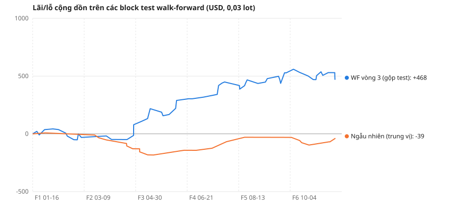

# Phase 7C — tín hiệu vào lệnh, vòng 3 (walk-forward + đối chứng ngẫu nhiên, offline)

> Chỉ là nghiên cứu offline. Không đổi runtime, cấu hình, BOT_MODE hay lệnh nào. Dữ liệu MT5 gốc không được commit.
> Nối tiếp [vòng 1–2](phase7c-entry-signals-report.md).

## Kết luận

- **Có một ứng viên đạt đủ ngưỡng ngoài mẫu của phiếu giao việc: N10 — phá Donchian 30 nến M15, cùng hướng SuperTrend H1, chỉ khi ATR14 M15 lớn hơn SMA100 của chính nó (biến động đang mở rộng).** Quản lý lệnh Phase 7C giữ nguyên.
  - Walk-forward 6 fold, chọn trên train và chấm trên block kế tiếp: **58 lệnh, PF 1,80, +468 USD, expectancy +8,07 USD/lệnh, R TB +0,27, 4/6 fold dương, Max DD 94 USD (3,3 R)** ở 0,03 lot.
  - Chia 50/50: IS PF 3,48 → OOS 38 lệnh, PF 1,63, +250 USD.
  - So với cấu hình hiện tại trên cùng 6 block test: hiện tại −1.008 USD, PF ~0,8.
- **Kết quả này vẫn chưa phải bằng chứng sinh lời**, vì:
  1. 12 tháng dữ liệu này đã được nhìn ở vòng 1–2. Nhóm "Donchian + ST H1" được chọn sau khi xem vòng 2. Bộ lọc ATR là ý mới, đăng ký trước, nhưng gốc của nó thì không sạch.
  2. Ít lệnh: khoảng 5–6 lệnh/tháng. Mỗi block test chỉ có 5–13 lệnh.
  3. Lợi nhuận tập trung: bỏ 3 lệnh lời nhất thì PF còn 1,50, bỏ 5 lệnh thì PF còn 1,22. Lệnh lời nhất (+221 USD, 7,3 R) vào lúc 23:05 thứ Sáu 27/02/2026, nhiều khả năng ôm qua cuối tuần.
  4. **Hai tháng gần nhất đều âm** (10/2026 −24 USD, 11/2026 −36 USD), và fold 6 âm (−60 USD, PF 0,67).
  5. Lời gần như toàn bộ nằm ở regime BREAKOUT. Ở TRENDING có ít lệnh và đều lỗ.
- **Đề xuất: không đổi bot. Khóa nguyên tham số N10 và chấm đúng một lần trên dữ liệu chưa ai xem** (xem phần "Đề xuất phê duyệt" bên dưới).



*Biểu đồ: lãi/lỗ cộng dồn (USD, 0,03 lot) của các lệnh trong block test walk-forward vòng 3, so với một tín hiệu ngẫu nhiên có tần suất trung vị.*

## Cách làm

- **Đăng ký trước:** danh sách 12 tín hiệu được commit trước khi chạy trên dữ liệu MT5 (commit `62a8495`). Sau đó không chỉnh tham số nào.
- Dữ liệu: MT5 M15 (23.671 nến) và M5 (71.008 nến), 25/11/2025 → 25/11/2026, giờ broker.
- Giả định bảo thủ như các vòng trước: STOP_FIRST, spread theo từng nến, trượt giá 0,10, phí 7 USD/lot, 0,03 lot, mỗi lúc một lệnh. Quản lý lệnh Phase 7C giữ nguyên (SL 6–10 + chờ hồi, BE +6 → entry, 1/3 ở +10, FastMove 10/10, M5 handoff). Khóa PAUSE (REVERSAL / UNCERTAIN) vẫn giữ.
- Tín hiệu đều nhân quả: chỉ đọc nến M15 đã đóng và nến H1/H4/D1 đã đóng. Test đã khóa điều này.
- **Đối chứng ngẫu nhiên mới (selection null):** chạy cùng bộ chọn walk-forward trên các bộ 12 tín hiệu hướng ngẫu nhiên, cùng SL và cùng quản lý lệnh, 400 lần. Nếu kết quả thật không vượt rõ phân phối này, thì "đạt" chỉ là chọn trúng đồng xu may nhất.
  - Lần chạy đầu, tần suất ngẫu nhiên đặt quá thấp (trung vị 19 lệnh/năm, thưa hơn hẳn ứng viên thật). Đã sửa thành hiệu chỉnh để trung vị số lệnh bằng ứng viên thật. Đây là thay đổi duy nhất sau khi chạy, và nó chỉ đụng đến đối chứng, không đụng ứng viên.

## 12 tín hiệu mới (đăng ký trước)

Cột: lệnh / PF / USD / R TB / Max DD USD (R) trong 12 tháng, rồi lãi/lỗ USD (PF) của từng block test.

| Tín hiệu | 12 tháng | F1 | F2 | F3 | F4 | F5 | F6 | Fold dương |
|---|---|---|---|---|---|---|---|---|
| N1 Bollinger squeeze + ST H1 | 27 / 0,86 / −54 / −0,09 / 187 (7,0) | 25 | −23 | 47 | −37 | 14 | 58 | 4/6 |
| N2 Donchian 30 + ST H1 + tick volume ≥ 1,5× | 29 / 1,27 / 84 / 0,11 / 92 (3,0) | 0 | 35 | 41 | 63 | −48 | 27 | 4/6 |
| N3 Donchian 30 + ST H1 + EMA50 H4 | 104 / 1,32 / 373 / 0,12 / 299 (9,9) | 145 | 84 | 133 | 66 | 145 | −24 | 5/6 |
| N4 Phá biên giờ đầu London | 31 / 0,42 / −294 / −0,33 / 357 (12,4) | −118 | 3 | −18 | −64 | 32 | 0 | 2/6 |
| N5 Như N4 + ST H1 | 22 / 0,50 / −175 / −0,29 / 239 (8,4) | −56 | 3 | −20 | −32 | 33 | 0 | 2/6 |
| N6 Phá biên giờ đầu New York + ST H1 | 6 / 3,71 / 85 / 0,46 / 31 (1,0) | 37 | 0 | −6 | 0 | −1 | 22 | 2/6 |
| N7 Phá biên phiên Á + ST H1 | 24 / 0,96 / −9 / −0,03 / 147 (5,0) | 53 | 34 | 11 | −87 | −10 | 33 | 4/6 |
| N8 H1 inside bar + ST H1 | 52 / 0,74 / −150 / −0,09 / 216 (6,9) | −51 | −3 | 68 | −53 | −118 | 12 | 2/6 |
| N9 Donchian 20 cùng hướng nến ngày trước | 101 / 1,40 / 419 / 0,15 / 222 (7,4) | 149 | 23 | 228 | 44 | −37 | 129 | 5/6 |
| **N10 Donchian 30 + ST H1 + ATR mở rộng** | **67 / 2,20 / 699 / 0,35 / 91 (3,1)** | 182 | 110 | 211 | 160 | 79 | −60 | 5/6 |
| N11 Phá Donchian 20 rồi chờ retest | 183 / 0,93 / −143 / −0,03 / 321 (11,8) | −31 | 42 | 75 | −59 | −110 | 102 | 3/6 |
| N12 Đảo chiều trong RANGING (BB + RSI) | 3 / 0,00 / −85 / −1,01 / 85 (3,0) | 0 | 0 | 0 | −24 | 0 | 0 | 0/6 |

Hàng 12 tháng chứa cả dữ liệu train, nên **không dùng để chọn**. Con số trung thực là walk-forward bên dưới.

## Walk-forward (con số trung thực)

| Fold | Block test | Chọn (theo PF train) | Lệnh | PF | USD |
|---|---|---|---|---|---|
| 1 | 16/01 → 09/03/2026 | N11 breakout retest (train PF 0,59) | 12 | 0,80 | −31 |
| 2 | 09/03 → 30/04 | N10 (train PF 2,33) | 5 | 4,50 | +110 |
| 3 | 30/04 → 21/06 | N10 (2,71) | 8 | 4,42 | +211 |
| 4 | 21/06 → 13/08 | N10 (3,14) | 7 | 314 | +160 |
| 5 | 13/08 → 04/10 | N10 (3,79) | 13 | 1,51 | +79 |
| 6 | 04/10 → 25/11 | N10 (2,91) | 13 | 0,67 | −60 |
| **Gộp** | | | **58** | **1,80** | **+468** |

| Ngưỡng phiếu giao việc | Kết quả | Đạt |
|---|---|---|
| Số lệnh ngoài mẫu ≥ 30 | 58 | ✅ |
| PF > 1,20 | 1,80 | ✅ |
| Expectancy và R TB > 0 | +8,07 USD, +0,27 R | ✅ |
| Fold dương ≥ 4/6 | 4/6 | ✅ (vừa đủ) |
| Max DD | 94 USD / 3,3 R (hiện tại trên 12 tháng: 1.595 USD / 63,1 R) | báo cáo |

Gộp theo hướng: BUY 19 lệnh, PF 1,87, +110 USD. SELL 39 lệnh, PF 1,78, +358 USD. Theo regime: BREAKOUT 51 lệnh, PF 2,27, +589 USD. TRENDING 5 lệnh, −115 USD. RANGING 2 lệnh, −6 USD.

## Có hơn ngẫu nhiên không?

| Đối chứng (400 lần bốc bộ 12 tín hiệu ngẫu nhiên) | PF gộp p95 | USD gộp p95 | Tỷ lệ bộ ngẫu nhiên "đạt ngưỡng" | Kết quả thật vượt bao nhiêu % |
|---|---|---|---|---|
| A: tần suất bằng trung vị ứng viên (~31 lệnh/năm) | 3,26 | +154 | 0% | PF: 78%; USD: 100% |
| B: tần suất bằng N10 (~67 lệnh/năm) | 1,40 | +225 | 7,8% | PF: 100%; USD: 100% |
| C: bộ 31 tín hiệu (mọi tín hiệu đã thử ở vòng 1–3), tần suất N10 | 1,39 | +219 | 9,3% | PF: 100%; USD: 100% |

- Kết quả thật (+468 USD, PF 1,80) cao hơn mọi lần bốc ngẫu nhiên ở B và C. Như vậy khó giải thích kết quả chỉ bằng việc "chọn đồng xu may nhất" trong số các tín hiệu đã thử.
- Nhưng 8–9% bộ ngẫu nhiên vẫn "đạt" ngưỡng của phiếu. **Ngưỡng hiện tại khá lỏng khi mỗi fold chỉ có 5–13 lệnh.**
- Đối chứng ngẫu nhiên không bắt được lỗi do đã nhìn dữ liệu ở vòng 1–2. Lỗi đó chỉ kiểm được bằng dữ liệu mới.

## Độ bền của N10 (khám phá, làm sau khi đã thấy kết quả, không dùng để chỉnh)

**Vùng tham số lân cận:** Donchian 20/30/55 × tỷ lệ ATR 1,0/1,1/1,2 × SMA ATR 50/100/200, tổng 27 điểm.

- Cả 27 điểm đều có PF 12 tháng từ 1,34 đến 2,89. Trên 6 block test, PF từ 1,35 đến 4,46.
- 26/27 điểm có ≥ 4/6 fold dương.
- N10 không phải một điểm nhọn đơn lẻ: cả vùng đều dương.
- Bộ lọc ATR quyết định phần lớn. Ở tỷ lệ 1,1–1,2, chu kỳ Donchian gần như không đổi kết quả.

| Donchian | ATR > 1,0× SMA50 | 1,0× SMA100 | 1,0× SMA200 | 1,1× SMA100 | 1,2× SMA100 |
|---|---|---|---|---|---|
| 20 | 78 / 1,34 / +247 | 70 / 2,02 / +648 | 61 / 1,59 / +376 | 44 / 1,52 / +237 | 24 / 2,10 / +196 |
| 30 | 75 / 1,52 / +336 | **67 / 2,20 / +699** | 59 / 1,76 / +438 | 43 / 1,63 / +268 | 24 / 2,10 / +196 |
| 55 | 70 / 1,58 / +358 | 63 / 2,31 / +718 | 55 / 1,84 / +457 | 42 / 1,60 / +255 | 23 / 2,03 / +184 |

*Lệnh / PF / USD trong 12 tháng. Bảng đầy đủ 27 điểm có trong file JSON.*

**Chi phí xấu hơn** (12 tháng, N10):

| Kịch bản | Lệnh | PF | USD | R TB |
|---|---|---|---|---|
| Gốc | 67 | 2,20 | +699 | 0,35 |
| Trượt giá 0,30 | 67 | 2,08 | +664 | 0,32 |
| Phí 10 USD/lot | 67 | 2,19 | +693 | 0,34 |
| Spread × 1,5 | 65 | 2,16 | +671 | 0,34 |
| Cả ba | 65 | 2,05 | +642 | 0,32 |

**Theo tháng** (12 tháng, 0,03 lot): 12/2025 +27, 01/2026 −69, 02 +220, 03 +13, 04 +97, 05 +78, 06 +147, 07 +146, 08 +18, 09 +61, **10 −24, 11 −36**.

**Kiểu thoát lệnh:** 48/67 lệnh dừng ở SL sau BE, 19/67 lệnh dính SL ban đầu. 32 lệnh đã chốt 1/3 ở +10. Phần lời đến từ chốt 1/3 và trailing (FastMove / M5), không đến từ TP.

## Đề xuất để anh phê duyệt

**Tín hiệu khóa sẵn (không chỉnh thêm):**

- Nhánh TREND. Vào lệnh khi nến M15 vừa đóng phá đỉnh (BUY) hoặc đáy (SELL) của 30 nến M15 trước đó, và nến trước chưa phá.
- SuperTrend(10,3) H1 của nến H1 đã đóng phải cùng hướng.
- ATR14 M15 > SMA100(ATR14 M15).
- Không vào khi regime là PAUSE (REVERSAL / UNCERTAIN).
- SL: đáy/đỉnh 3 nến M15 gần nhất ± 1, trong khoảng 6–10. Nếu SL > 10 thì chờ hồi 15 phút, như hiện tại.
- Quản lý lệnh giữ nguyên Phase 7C. Khối lượng giữ nguyên.

**Bước kiểm chứng, theo thứ tự:**

1. **Kiểm mù trên dữ liệu cũ (khuyến nghị, nhanh nhất):** anh xuất từ MT5 dữ liệu M15 + M5 XAUUSD trước 25/11/2025 (ví dụ 01/2023 → 24/11/2025). Tôi chạy N10 đúng một lần với tham số đã khóa. Đạt khi PF > 1,20, ≥ 30 lệnh, expectancy > 0 và lời ở cả hai nửa.
2. Nếu bước 1 đạt: mở PR thêm N10 vào bot ở dạng **chỉ ghi log tín hiệu (shadow), mặc định TẮT**. Bot không đặt lệnh theo N10. Chạy song song trên DEMO để so tín hiệu thật với mô phỏng.
3. Chỉ sau khi có ≥ 30 tín hiệu shadow/DEMO khớp mô phỏng mới cân nhắc cho N10 đặt lệnh trên DEMO, theo kế hoạch T6. Với 5–6 lệnh/tháng, 30 lệnh mất khoảng 5–6 tháng. Đây là lý do nên làm bước 1 trước.

Nếu bước 1 trượt: bỏ N10, giữ tín hiệu hiện tại, và ghi nhận rằng 12 tháng dữ liệu này đã được dùng hết cho việc tìm tín hiệu.

## Chưa kiểm chứng được

- Chỉ có một năm dữ liệu, một broker, và dữ liệu đã được nhìn ở các vòng trước.
- Không mô phỏng: stop/freeze level của broker, giới hạn lỗ ngày, cổng độ tươi dữ liệu, SIDEWAY chạy song song, đóng lệnh trước cuối tuần.
- Lệnh lời nhất có thể đã ôm qua cuối tuần. Nếu bot thật đóng lệnh trước cuối tuần thì kết quả sẽ khác.
- Cổng SuperTrend M15 không đổi kết quả N10: chạy có hay không có cổng này cho ra cùng các lệnh. Khi đã có phá Donchian, ST H1 và ATR mở rộng, cổng M15 gần như luôn cùng hướng.
- Giờ phiên (N4–N7) theo giờ broker, không chỉnh DST.

## Chạy lại

```bash
node scripts/backtest/phase7c-entry-signals-r3.mjs --m5 <M5.csv> --m15 <M15.csv> \
  --cache .runtime/backtest/phase7c-replay-cache.json --svg docs/operations/phase7c-entry-signals-r3-equity.svg
node scripts/backtest/phase7c-entry-signals-r3-robustness.mjs --m5 <M5.csv> --m15 <M15.csv> \
  --cache .runtime/backtest/phase7c-replay-cache.json
node --test scripts/backtest/*.test.mjs
```

Với dữ liệu cũ hơn để kiểm mù, dùng cùng lệnh và chỉ đọc hàng N10. Không chạy lại walk-forward để chọn tín hiệu khác.
