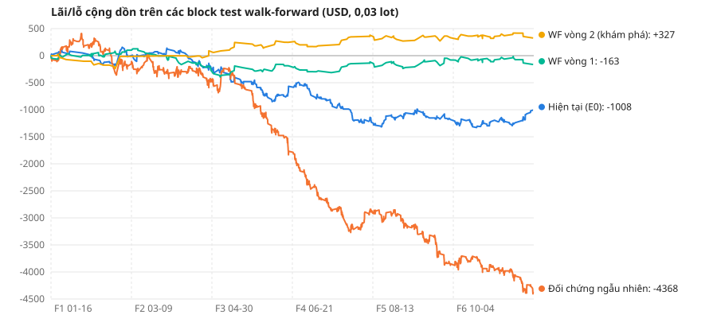

# Phase 7C — thử tín hiệu vào lệnh khác (walk-forward, offline)

> Chỉ là nghiên cứu offline. Không đổi runtime, cấu hình, BOT_MODE hay lệnh nào. Dữ liệu MT5 gốc không được commit.
> Phần này nối tiếp [báo cáo T3/T4](phase7c-management-sweep-report.md) và [báo cáo biến thể chiến lược](phase7c-strategy-variants-report.md).

## Kết luận

- **Không tín hiệu nào đạt ngưỡng của phiếu giao việc. Không có đề xuất cho DEMO.**
  - **Vòng 1** gồm 11 tín hiệu, cố định trước khi chạy. Walk-forward gộp được PF 0,93, −163 USD, expectancy −0,87 USD, 4/6 fold dương. Trượt ngưỡng PF > 1,20 và expectancy > 0.
  - **Vòng 2** dò thêm chu kỳ Donchian sau khi đã xem kết quả vòng 1. Walk-forward gộp được PF 1,25, +327 USD, nhưng chỉ 3/6 fold dương. Trượt ngưỡng ≥ 4/6. Vòng này cũng được chọn sau khi đã nhìn toàn bộ dữ liệu, nên dù đạt cũng không được tính là bằng chứng.
- **Tín hiệu hiện tại không tốt hơn vào lệnh ngẫu nhiên.** Pattern M15 + SuperTrend có PF 0,83–0,85 trong 12 tháng. Một đối chứng vào lệnh theo hướng ngẫu nhiên, dùng cùng SL và cùng cách quản lý lệnh, có PF 0,80. Mỗi lệnh ngẫu nhiên mất khoảng −0,1 R, gần đúng bằng chi phí: spread, trượt giá 0,10 và phí 7 USD/lot. Nghĩa là phần quản lý lệnh gần như trung tính, còn tín hiệu vào lệnh hầu như không có lợi thế.
- **Nhóm duy nhất đáng theo dõi là phá vỡ Donchian M15 cùng hướng SuperTrend H1.** Đây là nhóm ổn định nhất: nhiều chu kỳ (10/20/30/55) cho PF ≥ 1 và 4–5/6 fold dương khi xét riêng từng biến thể. Nhưng lợi thế mỏng và yếu dần ở hai block gần nhất (08–11/2026). Ở phép chia 50/50, E8 có PF 1,22 trong mẫu nhưng chỉ còn PF 1,02 ngoài mẫu. Muốn kiểm tra, cần chạy trên **dữ liệu mới chưa dùng** (từ 26/11/2026 trở đi) hoặc dữ liệu cũ hơn 11/2025, với tham số khóa sẵn (ví dụ Donchian 30 + ST H1).



*Biểu đồ: lãi/lỗ cộng dồn (USD, 0,03 lot) trên 6 block test, từ 16/01/2026. Đường ngẫu nhiên vào nhiều lệnh hơn (1.653 so với 557 của cấu hình hiện tại) nên lỗ USD lớn hơn. Nên so theo PF và R trong bảng.*

## Cách chấm (giữ nguyên giả định bảo thủ)

- Dữ liệu: MT5 M15 (23.671 nến) và M5 (71.008 nến), 25/11/2025 → 25/11/2026, giờ broker.
- Mô phỏng dùng lại `phase7c-management-sim.mjs`, quản lý lệnh **giữ nguyên**:
  - SL cấu trúc + đệm 1, trong khoảng 6–10; SL > 10 thì chờ hồi 15 phút.
  - BE +6 → entry; chốt 1/3 ở +10; FastMove 10/10; bàn giao trail M5; thoát runner theo MA50 / FVG.
  - STOP_FIRST khi SL và mục tiêu cùng nằm trong một nến; spread theo từng nến; trượt giá 0,10; phí 7 USD/lot; mỗi lúc chỉ một lệnh; 0,03 lot.
- Chỉ thay **tín hiệu** ở nhánh TREND. Tín hiệu mới dùng SL = đáy/đỉnh của 3 nến M15 gần nhất ± đệm 1.
- **Vẫn khóa PAUSE (REVERSAL / UNCERTAIN)** như LIVE AUTO. Lần chạy đầu tiên quên khóa này và cho kết quả đẹp hơn (vòng 2 đạt 4/6 fold). Kết quả đó đã bị loại vì bot thật không được vào lệnh trong REVERSAL.
- Walk-forward neo 6 fold, như PR trước: mỗi fold chọn tín hiệu có PF train cao nhất (≥ 20 lệnh train), rồi chấm trên block kế tiếp chưa thấy. Con số trung thực là dòng **"Gộp"**, không phải hàng tốt nhất trong bảng.
- Tất cả tín hiệu đều nhân quả: tín hiệu ở nến k chỉ đọc nến M15 ≤ k và nến H1 đã đóng. Test đã khóa điều này.

## Vòng 1 — 11 tín hiệu cố định trước + đối chứng

Cột: lệnh / PF / USD / R trung bình / Max DD USD (R) trong 12 tháng, sau đó lãi/lỗ USD (PF) của từng block test.

| Tín hiệu | 12 tháng: lệnh / PF / USD / avg R / Max DD USD (R) | F1 USD | F2 USD | F3 USD | F4 USD | F5 USD | F6 USD | Fold dương |
|---|---|---|---|---|---|---|---|---|
| E0_CURRENT_FULL — Hiện tại: pattern M15 + SuperTrend, TREND + SIDEWAY | 625 / 0.83 / -1189 / -0.076 / 1595 (63.1) | -19 (0.97) | -215 (0.81) | -332 (0.75) | -665 (0.54) | 50 (1.06) | 173 (1.19) | 2/6 |
| E1_CURRENT_TREND — Hiện tại, chỉ TREND | 566 / 0.85 / -959 / -0.064 / 1461 (57.3) | -59 (0.92) | -201 (0.81) | -354 (0.73) | -521 (0.59) | 64 (1.08) | 280 (1.37) | 2/6 |
| E2_PAT_H1_ST — Pattern hiện tại + SuperTrend H1 cùng hướng | 422 / 0.89 / -526 / -0.045 / 881 (35.9) | 133 (1.30) | -193 (0.78) | -57 (0.94) | -392 (0.58) | 8 (1.01) | 206 (1.35) | 3/6 |
| E3_PAT_H1_EMA50 — Pattern hiện tại + giá H1 cùng phía EMA50 H1 | 463 / 0.91 / -463 / -0.034 / 946 (37.1) | 42 (1.09) | -214 (0.77) | -31 (0.97) | -410 (0.62) | -1 (1.00) | 284 (1.46) | 2/6 |
| E4_PAT_SESSION — Pattern hiện tại, chỉ 10:00–19:59 giờ broker | 245 / 0.61 / -1217 / -0.204 / 1444 (59.3) | -95 (0.54) | -17 (0.96) | -371 (0.41) | -426 (0.37) | -152 (0.68) | 32 (1.11) | 1/6 |
| E5_PAT_FADE — Đảo chiều pattern hiện tại (mọi regime trừ PAUSE, không SuperTrend) | 1789 / 0.89 / -2137 / -0.072 / 2478 (146.7) | -472 (0.86) | -238 (0.93) | 121 (1.04) | -316 (0.88) | -620 (0.77) | -385 (0.84) | 1/6 |
| E6_DONCH20_REGIME — Phá đỉnh/đáy 20 nến M15 + ST M15, có cổng regime | 192 / 0.96 / -96 / -0.013 / 385 (13.6) | 114 (1.72) | 49 (1.32) | 84 (1.28) | -171 (0.56) | 58 (1.12) | -54 (0.88) | 4/6 |
| E7_DONCH20_ANY — Phá đỉnh/đáy 20 nến M15 + ST M15, mọi regime trừ PAUSE | 232 / 0.92 / -223 / -0.028 / 551 (19.3) | 15 (1.06) | 17 (1.09) | 129 (1.39) | -75 (0.82) | -21 (0.96) | -14 (0.97) | 3/6 |
| E8_DONCH20_H1ST — Phá 20 nến M15 + ST M15 + ST H1, mọi regime trừ PAUSE | 151 / 1.09 / 166 / 0.043 / 365 (12.7) | 145 (2.44) | 75 (1.85) | 157 (1.88) | 70 (1.45) | 37 (1.09) | -84 (0.80) | 5/6 |
| E9_EMA_PULLBACK — Hồi về EMA20 trong xu hướng EMA20>EMA50, mọi regime trừ PAUSE | 332 / 0.95 / -199 / -0.033 / 714 (27.9) | 101 (1.23) | -432 (0.44) | -14 (0.97) | -74 (0.88) | -91 (0.83) | 25 (1.05) | 2/6 |
| E10_EMA_PULLBACK_H1ST — Hồi EMA20 + ST H1 cùng hướng, mọi regime trừ PAUSE | 262 / 1.00 / -1 / -0.006 / 565 (20.9) | 113 (1.33) | -372 (0.40) | -63 (0.85) | -88 (0.82) | 47 (1.15) | 133 (1.35) | 3/6 |
| E11_RSI2_MR_H1 — RSI(2) quá bán/quá mua theo xu hướng EMA50 H1, mọi regime trừ PAUSE | 283 / 0.81 / -583 / -0.125 / 828 (43.0) | -51 (0.85) | -122 (0.80) | -207 (0.43) | -217 (0.63) | 19 (1.04) | -45 (0.90) | 1/6 |
| X_RANDOM (đối chứng) — Đối chứng: hướng ngẫu nhiên, cùng SL và quản lý lệnh | 1849 / 0.80 / -4219 / -0.105 / 4814 (218.5) | -140 (0.95) | -318 (0.91) | -1309 (0.65) | -1134 (0.67) | -948 (0.71) | -517 (0.81) | 0/6 |

Walk-forward:

Walk-forward (chọn trên train, chấm block kế tiếp):
- Fold 1 (2026-01-16 → 2026-03-09): chọn E9_EMA_PULLBACK (train PF 1.80) → 46 lệnh, PF 1.23, 101 USD
- Fold 2 (2026-03-09 → 2026-04-30): chọn E10_EMA_PULLBACK_H1ST (train PF 1.52) → 38 lệnh, PF 0.40, -372 USD
- Fold 3 (2026-04-30 → 2026-06-21): chọn E6_DONCH20_REGIME (train PF 0.98) → 25 lệnh, PF 1.28, 84 USD
- Fold 4 (2026-06-21 → 2026-08-13): chọn E8_DONCH20_H1ST (train PF 1.18) → 18 lệnh, PF 1.45, 70 USD
- Fold 5 (2026-08-13 → 2026-10-04): chọn E8_DONCH20_H1ST (train PF 1.23) → 29 lệnh, PF 1.09, 37 USD
- Fold 6 (2026-10-04 → 2026-11-25): chọn E8_DONCH20_H1ST (train PF 1.19) → 31 lệnh, PF 0.80, -84 USD

Gộp: {"trades":187,"netUsd":-163.26,"profitFactor":0.931,"expectancyUsd":-0.873,"avgR":-0.037,"winRate":0.401,"maxDrawdownUsd":520.49,"maxDrawdownR":18.72} | fold dương 4/6 | ngưỡng: {"tradesAtLeast30":true,"profitFactorAbove1_20":false,"expectancyPositive":false,"avgRPositive":false,"positiveFoldsAtLeast4of6":true}

Chia 50/50 (mốc 2026-05-26): chọn E8_DONCH20_H1ST theo IS PF 1.22 → OOS {"trades":89,"netUsd":26.12,"profitFactor":1.023,"expectancyUsd":0.293,"avgR":0.026,"winRate":0.427,"maxDrawdownUsd":151.62,"maxDrawdownR":5.17}

## Vòng 2 — khám phá chu kỳ Donchian (đã thấy vòng 1)

| Tín hiệu | 12 tháng | F1 | F2 | F3 | F4 | F5 | F6 | Fold dương |
|---|---|---|---|---|---|---|---|---|
| R2_DONCH10 | 272 / 0.97 / -103 / -0.014 / 511 (17.5) | -16 (0.94) | -32 (0.86) | 123 (1.30) | -109 (0.82) | -4 (0.99) | 138 (1.29) | 2/6 |
| R2_DONCH10_H1ST | 181 / 1.14 / 283 / 0.052 / 317 (10.9) | 114 (1.87) | 26 (1.19) | 167 (1.73) | -18 (0.94) | 62 (1.14) | 87 (1.21) | 5/6 |
| R2_DONCH20 | 232 / 0.92 / -223 / -0.028 / 551 (19.3) | 15 (1.06) | 17 (1.09) | 129 (1.39) | -75 (0.82) | -21 (0.96) | -14 (0.97) | 3/6 |
| R2_DONCH20_H1ST | 151 / 1.09 / 166 / 0.043 / 365 (12.7) | 145 (2.44) | 75 (1.85) | 157 (1.88) | 70 (1.45) | 37 (1.09) | -84 (0.80) | 5/6 |
| R2_DONCH30 | 210 / 1.00 / 10 / 0.006 / 457 (15.9) | 46 (1.20) | 48 (1.32) | 114 (1.34) | 19 (1.06) | -54 (0.90) | 95 (1.25) | 5/6 |
| R2_DONCH30_H1ST | 141 / 1.17 / 272 / 0.067 / 324 (11.3) | 145 (2.44) | 75 (1.85) | 157 (1.88) | 101 (1.81) | -14 (0.96) | 1 (1.00) | 5/6 |
| R2_DONCH55 | 151 / 1.20 / 323 / 0.071 / 259 (9.4) | 112 (1.84) | 106 (2.85) | 234 (2.31) | 112 (1.61) | -122 (0.73) | 7 (1.02) | 5/6 |
| R2_DONCH55_H1ST | 124 / 1.27 / 369 / 0.101 / 250 (8.9) | 145 (2.45) | 106 (2.88) | 157 (1.88) | 132 (2.40) | -47 (0.87) | -5 (0.98) | 4/6 |

- Fold 1: chọn R2_DONCH10 (train PF 0.63) → 19 lệnh, PF 0.94, -16 USD
- Fold 2: chọn R2_DONCH55_H1ST (train PF 1.08) → 10 lệnh, PF 2.88, 106 USD
- Fold 3: chọn R2_DONCH55_H1ST (train PF 1.35) → 17 lệnh, PF 1.88, 157 USD
- Fold 4: chọn R2_DONCH55_H1ST (train PF 1.52) → 16 lệnh, PF 2.40, 132 USD
- Fold 5: chọn R2_DONCH55_H1ST (train PF 1.65) → 23 lệnh, PF 0.87, -47 USD
- Fold 6: chọn R2_DONCH55_H1ST (train PF 1.36) → 26 lệnh, PF 0.98, -5 USD
Gộp vòng 2: {"trades":111,"netUsd":326.68,"profitFactor":1.248,"expectancyUsd":2.943,"avgR":0.107,"winRate":0.396,"maxDrawdownUsd":260.95,"maxDrawdownR":8.55} | fold dương 3/6 | ngưỡng: {"tradesAtLeast30":true,"profitFactorAbove1_20":true,"expectancyPositive":true,"avgRPositive":true,"positiveFoldsAtLeast4of6":false}

## Theo BUY/SELL và regime (12 tháng)

| Tín hiệu | BUY: lệnh / PF / USD | SELL | BREAKOUT | RANGING | TRENDING |
|---|---|---|---|---|---|
| E0 hiện tại (TREND + SIDEWAY) | 273 / 0,93 / −220 | 352 / 0,76 / −969 | 506 / 0,86 / −854 | 60 / 0,61 / −215 | 59 / 0,81 / −121 |
| E8 Donchian 20 + ST H1 | 69 / 0,96 / −32 | 82 / 1,19 / +197 | 130 / 1,28 / +401 | 14 / 0,82 / −24 | 7 / 0,00 / −212 |
| R2 Donchian 55 + ST H1 (chọn sau) | 54 / 1,32 / +151 | 70 / 1,25 / +218 | 113 / 1,39 / +466 | 7 / 1,59 / +23 | 4 / 0,00 / −120 |
| Walk-forward vòng 1 (gộp test) | 70 / 0,80 / −167 | 117 / 1,00 / +4 | — | — | — |

Phần lời của nhóm Donchian nằm gần như toàn bộ trong regime BREAKOUT. Ở TRENDING có rất ít lệnh và đều lỗ.

## Max drawdown so với cấu hình hiện tại (12 tháng, 0,03 lot)

| | Max DD USD | Max DD R |
|---|---|---|
| Hiện tại E0 | 1.595 | 63,1 |
| Walk-forward vòng 1 (gộp test) | 520 | 18,7 |
| Walk-forward vòng 2 (gộp test, khám phá) | 261 | 8,6 |

DD của nhóm Donchian thấp hơn chủ yếu vì ít lệnh hơn (khoảng 110–190 lệnh so với 625), không phải vì rủi ro mỗi lệnh nhỏ hơn.

## Chưa kiểm chứng được

- Chỉ có 12 tháng dữ liệu, một broker, một chế độ spread. Mỗi block test của nhóm Donchian chỉ có 10–30 lệnh, nên PF từng fold dao động rất mạnh.
- Không mô phỏng: stop level / freeze level của broker, giới hạn lỗ ngày, các cổng độ tươi dữ liệu, SIDEWAY chạy song song với tín hiệu mới (tín hiệu mới chạy một mình ở nhánh TREND).
- Giờ phiên (E4) dùng giờ broker và không chỉnh DST.

## Việc nên làm tiếp

1. Không đổi tín hiệu trên bot. Nếu muốn theo đuổi nhóm Donchian + ST H1, **khóa tham số ngay bây giờ** (ví dụ Donchian 30 + ST H1, giữ nguyên quản lý lệnh) rồi chấm trên dữ liệu MT5 **mới** sau 25/11/2026, hoặc dữ liệu trước 11/2025 nếu xuất được. Chỉ chấm một lần, không chỉnh thêm.
2. Lỗ của đối chứng ngẫu nhiên cho thấy chi phí khoảng 0,1 R mỗi lệnh. Mọi tín hiệu mới cần lợi thế gộp lớn hơn mức đó một cách rõ ràng.

## Chạy lại

```bash
node scripts/backtest/phase7c-entry-signals.mjs --m5 <M5.csv> --m15 <M15.csv> \
  --cache .runtime/backtest/phase7c-replay-cache.json --svg docs/operations/phase7c-entry-signals-equity.svg
node --test scripts/backtest/*.test.mjs
```
