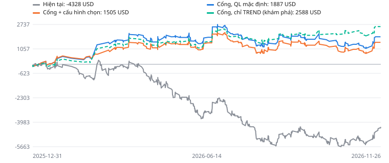

# Phase 7C vòng 4 — cổng xu hướng thư viện + quản lý lệnh (kết quả, offline)

> Chỉ là nghiên cứu offline. Không đổi runtime, cấu hình, BOT_MODE hay lệnh nào. Dữ liệu MT5 gốc không được commit.
> Kế hoạch đăng ký trước: [phase7c-trend-gate-management-r4-plan.md](phase7c-trend-gate-management-r4-plan.md) (commit trước khi chạy).

## Kết luận

- **Không đạt.** Cổng `WITH_TREND_ONLY` kết hợp lưới SL/BE/TP (108 cấu hình) không vượt ngưỡng của phiếu giao việc.
  - Cấu hình được chọn trên đoạn trong mẫu (vùng ổn định): **BE +6 → entry, SL 6–10, TP cố định 30**.
  - Ngoài mẫu (31/12/2025 → 26/11/2026): 257 lệnh, **PF 1,15**, +1.505 USD, R TB +0,06.
  - Walk-forward: **3/6 fold dương**, gộp PF 1,03.
- **Đổi SL/BE/TP không giúp nâng PF.** Quản lý lệnh hiện tại (BE +6 → entry, trần SL 10, TP tắt) đã nằm trong vùng tốt nhất.
  - Trần SL 12 hoặc 15 làm kết quả xấu đi rõ, cả trong mẫu lẫn ngoài mẫu.
  - BE 8/10, offset 1/2 và TP 20/30/40 chỉ làm PF lệch khoảng ±0,05, không có hướng ổn định.
  - Chỉ 1/108 cấu hình có PF ngoài mẫu > 1,20 (BE8/OFF0/SL10/TPoff: PF 1,203). Kết quả này là nhiễu, không được chọn.
- Riêng **cổng xu hướng vẫn có tác dụng lớn**: ngoài mẫu từ PF 0,84 (−4.328 USD) lên 1,19 (+1.887 USD), max DD từ 5.943 USD xuống 1.647 USD.
  Nhưng trong mẫu cổng chỉ đưa PF lên 1,03. Phần lớn mức cải thiện đến từ năm 2026.
- **Phát hiện khám phá (không đăng ký trước):** SIDEWAY lỗ ở cả hai đoạn: trong mẫu PF 0,87, ngoài mẫu PF 0,66.
  Nếu bật cổng và chỉ chạy TREND, ngoài mẫu đạt 197 lệnh, PF 1,32, +2.588 USD, 5/6 block dương.
  - **Không dùng con số này để nghiệm thu.** Ý tưởng này được thêm sau khi đã xem kết quả ngoài mẫu.
  - Kết quả cũng rất mong manh: bỏ 5 lệnh lời nhất thì PF ngoài mẫu còn 1,02.
- **Đề xuất: không đổi bot.** Nếu muốn đi tiếp, xem phần "Bước tiếp theo".



*Biểu đồ: lãi/lỗ cộng dồn (USD, 0,12 lot) trên đoạn ngoài mẫu 31/12/2025 → 26/11/2026. Đường nét đứt là cấu hình khám phá, không đăng ký trước.*

## Cách làm

- Dữ liệu: MT5 XAUUSD.G, 27/11/2023 → 26/11/2026, gồm 70.979 nến M15 và nến M5, H1, H4 tương ứng. Giờ tính theo giờ broker.
- **Cổng chạy trong mô phỏng**, không chỉ bỏ lệnh khỏi danh sách có sẵn. Khi một lệnh TREND bị chặn, bot có thể mở lệnh khác thay vào, và mô phỏng tính cả trường hợp đó.
  Vì vậy con số "cổng bật, quản lý mặc định" ở đây (PF 1,187) hơi khác báo cáo đề xuất C2 (PF 1,20).
- Trạng thái thư viện lấy từ nến H1/H4 đã đóng tại lúc có tín hiệu (nhân quả, đã có test).
- Giả định bảo thủ: STOP_FIRST, spread theo từng nến M5, trượt giá 0,10, phí 7 USD/lot, 0,12 lot, mỗi lúc chỉ một lệnh.
- Chọn cấu hình bằng `selectStable`: trung vị PF của cấu hình và các láng giềng trong lưới trên đoạn trong mẫu. Cách này ưu tiên vùng ổn định hơn một điểm đỉnh đơn lẻ.

## Kết quả chính

Cột: lệnh / PF / ròng USD / kỳ vọng USD / R TB / Max DD USD (R).

| Cấu hình | Trong mẫu (→ 31/12/2025) | Ngoài mẫu (31/12/2025 →) |
|---|---|---|
| Hiện tại (cổng tắt, BE6/OFF0/SL10/TPoff) | 1162 / 0,93 / −3.234 / −2,78 / −0,04 / 4.377 (59,4 R) | 583 / 0,84 / −4.328 / −7,42 / −0,07 / 5.943 (61,8 R) |
| Cổng bật, quản lý mặc định | 598 / 1,03 / +600 / +1,00 / +0,00 / 1.681 (21,6 R) | 255 / 1,19 / +1.887 / +7,40 / +0,09 / 1.647 (17,2 R) |
| **Cổng bật + cấu hình chọn (BE6/OFF0/SL10/TP30)** | 598 / 1,03 / +657 / +1,10 / +0,00 / 1.681 (21,4 R) | **257 / 1,15 / +1.505 / +5,86 / +0,06 / 1.500 (16,2 R)** |
| *Khám phá: cổng bật, chỉ TREND* | *355 / 1,10 / +1.300 / +3,66 / +0,03 / 1.426 (21,4 R)* | *197 / 1,32 / +2.588 / +13,14 / +0,16 / 1.033 (11,4 R)* |

| Ngưỡng phiếu giao việc | Cổng + cấu hình chọn | Đạt |
|---|---|---|
| Số lệnh ngoài mẫu ≥ 30 | 257 | ✅ |
| PF > 1,20 | 1,15 | ❌ |
| Expectancy và R TB > 0 | +5,86 USD, +0,06 R | ✅ |
| Fold walk-forward dương ≥ 4/6 | 3/6 | ❌ |
| Max DD | 1.500 USD / 16,2 R (hiện tại: 5.943 USD / 61,8 R) | báo cáo |

## Walk-forward 6 fold

Cột: lệnh / PF / USD.

| Fold | Block test | Chọn trên train | Kết quả WF | Hiện tại | Cổng, QL mặc định | *Khám phá: chỉ TREND* |
|---|---|---|---|---|---|---|
| 1 | 01/05 → 05/10/2024 | BE6/OFF0/SL10/TP20 | 109 / 1,25 / +831 | 207 / 0,96 / −281 | 108 / 1,27 / +866 | 59 / 1,31 / +656 |
| 2 | 05/10/2024 → 10/03/2025 | BE6/OFF0/SL10/TP20 | 127 / 0,81 / −794 | 232 / 0,81 / −1.683 | 127 / 0,82 / −748 | 76 / 0,72 / −912 |
| 3 | 10/03 → 13/08/2025 | BE10/OFF1/SL15/TPoff | 171 / 0,92 / −551 | 302 / 1,16 / +1.696 | 159 / 1,13 / +642 | 86 / 1,11 / +375 |
| 4 | 13/08/2025 → 17/01/2026 | BE6/OFF0/SL10/TP30 | 134 / 1,16 / +731 | 264 / 0,83 / −1.909 | 134 / 1,16 / +761 | 97 / 1,39 / +1.337 |
| 5 | 17/01 → 22/06/2026 | BE6/OFF0/SL10/TP30 | 109 / 1,51 / +2.080 | 256 / 0,81 / −2.402 | 107 / 1,65 / +2.573 | 89 / 1,69 / +2.447 |
| 6 | 22/06 → 26/11/2026 | BE10/OFF0/SL10/TPoff | 132 / 0,78 / −1.537 | 302 / 0,87 / −1.644 | 138 / 0,88 / −685 | 101 / 1,08 / +312 |
| **Gộp** | | | **782 / 1,03 / +760** | | | |

- Trong 6 fold, bộ chọn đổi cấu hình 4 lần. Fold 3 chọn trần SL 15 và lỗ, trong khi giữ mặc định thì lời. Lưới quản lý lệnh chủ yếu thêm nhiễu.
- Cổng với quản lý mặc định tốt hơn cấu hình hiện tại ở 5/6 fold. Fold 3 là ngoại lệ.

## Vùng tham số (PF trong mẫu → ngoài mẫu, cổng bật)

| | TP tắt | TP 20 | TP 30 | TP 40 |
|---|---|---|---|---|
| BE6 / OFF0 / SL10 | 1,03 → 1,19 | 1,05 → 1,09 | 1,03 → 1,15 | 1,04 → 1,15 |
| BE8 / OFF0 / SL10 | 1,01 → 1,20 | 1,03 → 1,10 | 1,01 → 1,16 | 1,02 → 1,17 |
| BE10 / OFF0 / SL10 | 1,03 → 1,11 | 1,05 → 1,02 | 1,03 → 1,08 | 1,03 → 1,08 |
| BE6 / OFF0 / SL12 | 0,99 → 0,98 | 1,01 → 0,97 | 0,99 → 0,97 | 1,00 → 0,95 |
| BE6 / OFF0 / SL15 | 1,00 → 0,91 | 1,02 → 0,90 | 1,01 → 0,90 | 1,01 → 0,87 |

Offset BE 1 và 2 (SL10, TP tắt) cho PF ngoài mẫu 1,09–1,13. Không tốt hơn offset 0.
Bảng đầy đủ 108 cấu hình có trong file JSON của lần chạy.

## Chi tiết cấu hình chọn (ngoài mẫu)

- **Theo hướng:** BUY 104 lệnh, PF 1,06, +253 USD. SELL 153 lệnh, PF 1,21, +1.252 USD.
- **Theo regime:**
  - BREAKOUT: 194 lệnh, PF 1,32, +2.448 USD.
  - RANGING (SIDEWAY): 58 lệnh, PF 0,66, −701 USD.
  - TRENDING: 5 lệnh, −243 USD.
- **Kiểu thoát lệnh:** 131 lệnh dừng ở SL sau BE, 109 lệnh dính SL ban đầu, 17 lệnh chạm TP.
- **Bỏ 3 lệnh lời nhất:** PF còn 1,07.
- **Chi phí xấu hơn:**

  | Kịch bản | PF | USD |
  |---|---|---|
  | Trượt giá 0,30 | 1,04 | +391 |
  | Phí 10 USD/lot | 1,14 | +1.412 |
  | Spread × 1,5 | 1,16 | +1.586 |
  | Cả ba | 1,01 | +141 |

  Lợi thế rất mỏng: trượt giá thêm 0,20 là gần hết lãi.
- **Theo tháng (USD):**

  | Tháng | USD |
  |---|---|
  | 12/2025 | −146 |
  | 01/2026 | +721 |
  | 02/2026 | +120 |
  | 03/2026 | +582 |
  | 04/2026 | −112 |
  | 05/2026 | +8 |
  | 06/2026 | +943 |
  | 07/2026 | −1.305 |
  | 08/2026 | +678 |
  | 09/2026 | −111 |
  | 10/2026 | −351 |
  | 11/2026 | +479 |

## Bước tiếp theo (cần anh quyết)

1. **Giữ nguyên quản lý lệnh** (BE +6 → entry, SL 6–10, TP tắt). Vòng này cho thấy đổi SL/BE/TP không phải đòn bẩy để nâng PF. Nhiệm vụ T5 không có cấu hình SL/BE/TP nào để đề xuất.
2. Đòn bẩy thật nằm ở **chọn lệnh**: cổng xu hướng, và có thể tắt SIDEWAY. Muốn biết có thật hay không, cần dữ liệu chưa ai xem:
   - Khóa sẵn giả thuyết "cổng WITH_TREND_ONLY + chỉ TREND + quản lý mặc định", không chỉnh thêm.
   - Anh xuất M5/M15/H1/H4 **trước 27/11/2023** (ví dụ 2020–2023), rồi tôi chạy đúng một lần.
   - Đạt khi PF > 1,20, ≥ 30 lệnh, expectancy > 0, và ≥ 4/6 block dương.
3. Nếu bước 2 đạt: mở PR nối cổng vào bot ở dạng **shadow, mặc định TẮT**, rồi chạy DEMO theo T6.
   Nếu bước 2 trượt: dừng tối ưu trên bộ dữ liệu này, vì 3 năm dữ liệu đã được dùng hết cho việc tìm ý tưởng.

## Chưa kiểm chứng được

- Cổng được chọn sau khi đã xem chính bộ dữ liệu này. Đoạn ngoài mẫu đã được nhìn ở báo cáo đề xuất C2, nên không hoàn toàn sạch.
- Mô phỏng dùng lot cố định 0,12 cho cả SIDEWAY. Bot thật dùng rủi ro 1% cho SIDEWAY, nên USD sẽ khác. Các chỉ số R không phụ thuộc lot.
- Không mô phỏng:
  - stop/freeze level của broker;
  - giới hạn lỗ ngày, RECOVERY;
  - cổng độ tươi dữ liệu;
  - đóng lệnh trước cuối tuần;
  - lệnh REVERSAL.
- Không có dữ liệu tick. STOP_FIRST trong cùng nến M5 là giả định bảo thủ, không phải khớp thực tế.

## Chạy lại

```bash
node scripts/backtest/phase7c-trend-gate-r4.mjs --m5 <M5.csv> --m15 <M15.csv> --h1 <H1.csv> --h4 <H4.csv> \
  --cache .runtime/backtest/phase7c-replay-cache.json --out .runtime/backtest/phase7c-r4.json \
  --svg docs/research/phase7c-trend-gate-r4-equity.svg
node --test scripts/backtest/*.test.mjs
```
